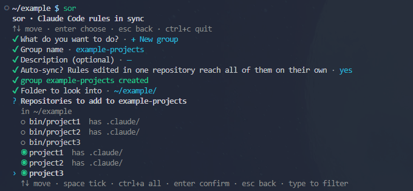
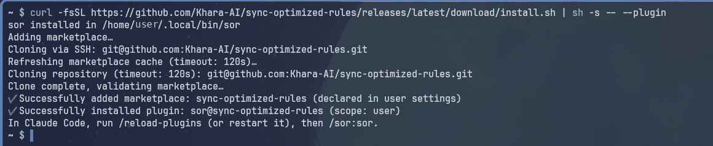
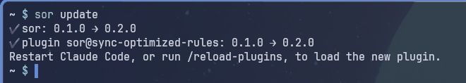
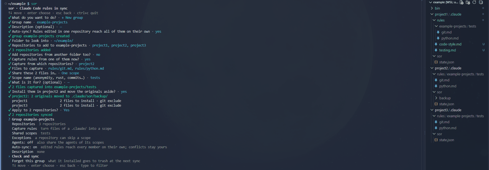
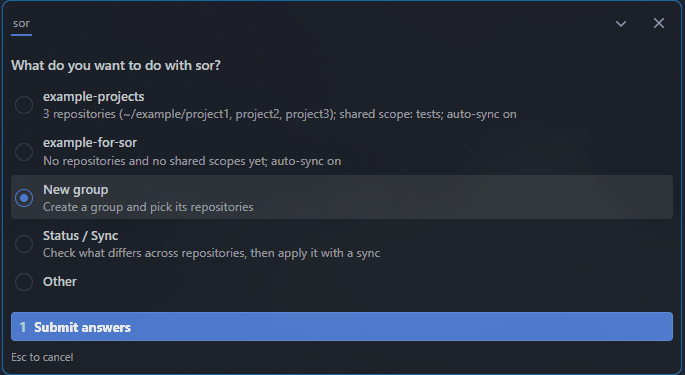
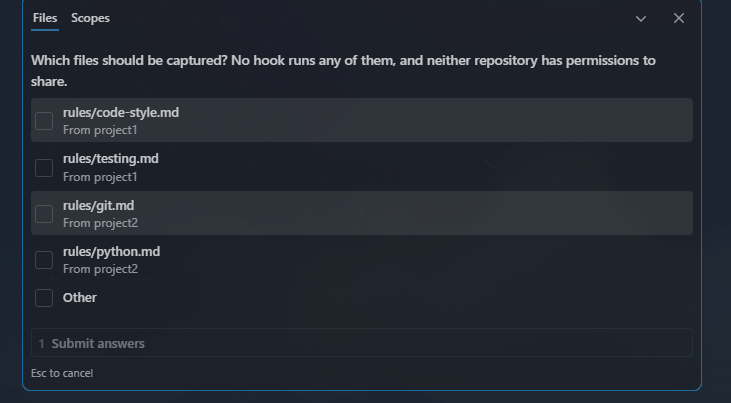
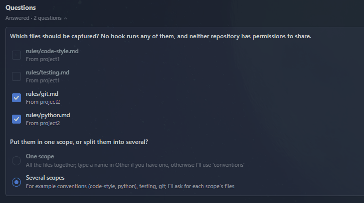

# sync-optimized-rules

`sor` keeps the Claude Code rules of many repositories in sync. Gather repositories into groups, choose the scopes each group shares, and `sor` installs them in every member, locally and without overwriting what you wrote by hand.



> Early stage: the configuration format may still change.

## Install

Linux and macOS:

```sh
curl -fsSL https://github.com/Khara-AI/sync-optimized-rules/releases/latest/download/install.sh | sh -s -- --plugin
```

Windows (PowerShell):

```powershell
$env:SOR_PLUGIN = 1; irm https://github.com/Khara-AI/sync-optimized-rules/releases/latest/download/install.ps1 | iex
```

This installs `sor` and its Claude Code plugin. For `sor` alone, the plugin alone, a build from source or uninstalling, see the [full guide](docs/usage.md#install).



Update both with `sor update`.



## Use

**In a terminal**, run `sor`. Arrows move, space ticks, enter confirms, esc goes back.



**In Claude Code**, type `/sor:sor`. Claude asks the same questions and runs `sor` for you.







**From scripts**, every step is a command that accepts `--json`: see `sor --help`.

The [full guide](docs/usage.md) covers auto-sync, conflicts, exceptions and every command. The [design notes](docs/design.md) explain how files are compared and merged.

## Principles

- **Local.** Nothing leaves your machine; installed files stay out of git.
- **No overwrite.** A file you edited becomes a conflict you resolve; retired files are moved aside, not deleted.
- **Scopes, not everything.** A group shares the scopes you pick, and a repository can opt out of one.

## License

Copyright 2026 Khara-AI. Licensed under the [Apache License 2.0](LICENSE).
